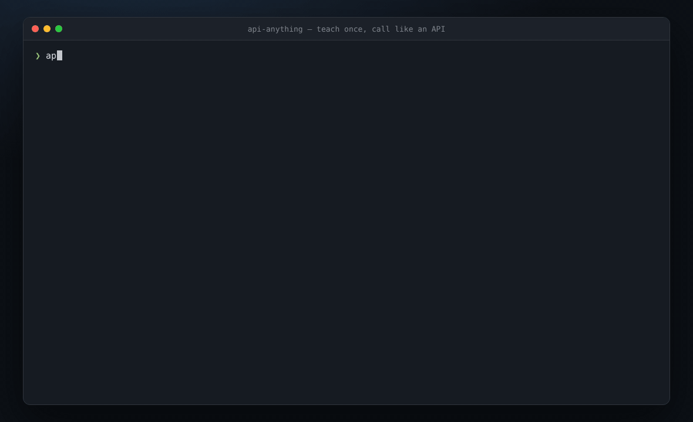
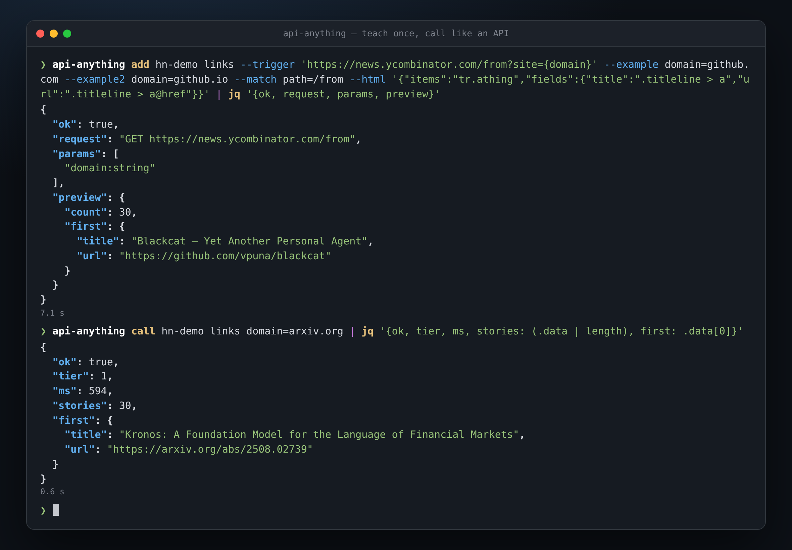
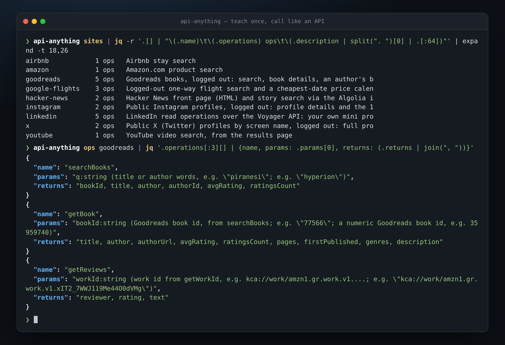
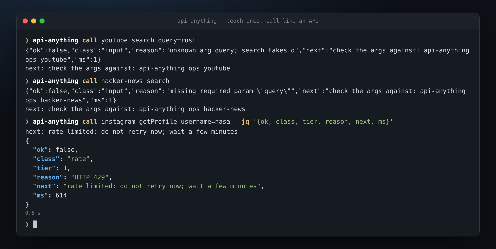

# All-api

[](https://github.com/Liohtml/All-api/actions/workflows/ci.yml)
[](rust/)
[](LICENSE)

**Teach it a website once. After that, your agent calls the site like an API instead of driving a browser.**

All-api watches a site's own page make a request and learns which parts of that request are your
inputs. It saves the result as an *operation*. From then on, an agent (or a script, or you) calls
that operation with new inputs over MCP, the CLI or a library, and gets JSON back over plain HTTP.
It ships as one Rust binary, `api-anything`, with the bundled sites compiled in.

[](docs/media/hero.png)

<sub>Recorded 2026-10-10 with the Rust binary against the live sites. The typing is animated, the
output is what the commands printed, and the 7 s Chrome wait during `add` is shown shortened.
[Still image](docs/media/hero.png) · [how it was recorded](docs/media/README.md)</sub>

## Why

- **One binary, nothing else.** A static Rust build with the site specs embedded. No Node, no
  Playwright, no package manager at call time.
- **Plain HTTP by default.** A call sends the learned request with a normal HTTP client and
  answers in well under a second. Chrome is needed only to teach a site, and as a fallback.
- **Repairs itself.** When a site rotates an id or moves a field, the operation is re-learned
  from the page and saved again only after a replay succeeds.
- **Made for agents.** An MCP server with four tools, a skill that teaches an agent to map a
  site from an intent, and an error contract that always says what to do next.

## Install

With a Rust toolchain (1.85 or newer):

```sh
cargo install --git https://github.com/Liohtml/All-api api-anything
api-anything call hacker-news search query=sqlite
```

```json
{"ok":true,"class":"ok","tier":1,"data":[{"title":"Hosting SQLite databases on GitHub Pages or any static file hoster","url":"https://phiresky.github.io/blog/2021/hosting-sqlite-databases-on-github-pages/","points":1812,"num_comments":244, ...}, ...],"ms":111}
```

`tier: 1` means plain HTTP with no browser. Google Chrome (or any Chromium, named by
`API_ANYTHING_CHROME`) is needed only to teach new sites and for the browser fallback.

<details>
<summary>Let an agent install it</summary>

Paste this into Claude Code, Codex or another coding agent:

```text
Set up All-api for me: https://github.com/Liohtml/All-api/blob/main/INSTALL.md
```

The agent builds and installs the `api-anything` command, confirms that a call works, then
connects the MCP server and the skill to itself. Restart the agent, then ask it something like
"What does Goodreads rate Piranesi?"

</details>

<details>
<summary>The TypeScript build</summary>

The original TypeScript implementation is kept in `src/` and behaves the same. It needs Node
22.13 or newer:

```sh
git clone https://github.com/Liohtml/All-api.git && cd All-api
npm ci && npm install -g "$(npm pack --silent)"
```

Both builds keep their data under `~/.api-anything`, so specs, sessions and captures made with one
are used by the other. [How the Rust crate maps to the TypeScript](rust/PORTING.md).

</details>

## Teach it a new site

Give it the page URL with a placeholder and two example inputs. Headless Chrome loads the page
once per example, and the part of the request that changed with the input becomes a parameter.
The rest is stored as a template. No LLM is involved.

```sh
api-anything add hn-demo links \
  --trigger 'https://news.ycombinator.com/from?site={domain}' \
  --example domain=github.com --example2 domain=github.io --match path=/from \
  --html '{"items":"tr.athing","fields":{"title":".titleline > a","url":".titleline > a@href"}}'

api-anything call hn-demo links domain=arxiv.org      # 30 arxiv.org stories, tier 1, 0.6 s
```

[](docs/media/teach.png)

`--html` picks the fields out of an HTML page. For a JSON response, `--extract data.items`
names the path instead, and `api-anything capture <url> --outline` shows what each request on a
page returns, so you (or an agent) can choose. [Reference](docs/REFERENCE.md).

## What's included

29 read operations across 10 sites, compiled into the binary:

[](docs/media/sites.png)

- `google-flights`: search, top flights, price calendar
- `hacker-news`: front page and story search
- `goodreads`: search, books, work ids, reviews, an author's books
- `x` and `instagram` profiles
- search on `youtube`, `airbnb` and `amazon`
- `linkedin`: profiles, companies and search, with your own login
- `trustpilot`: business search, rating summary, review topics, and reviews page by page (all, or one star rating)

They cover selected features, not whole sites. `api-anything ops <site>` lists each operation's
parameters, fields and caveats. No write operations are bundled.

## When it can't answer

Every call returns the same shape. A failure is `ok: false` with a `class` that says what kind of
failure it is, a `reason`, and a `next` step an agent can act on. Nothing is retried blindly, and
an error never returns someone else's data.

[](docs/media/errors.png)

| class | meaning | what `next` says |
|---|---|---|
| `input` | the arguments don't fit the operation | which parameters it takes |
| `auth` | the session is missing or expired | the `login` command to run |
| `rate` | the site is rate limiting | wait before retrying |
| `blocked` | a bot wall or challenge | run `login` and clear the challenge, then retry once |
| `drift` | the site changed and the repair failed | `heal`, then re-learn with `add` |
| `error` | anything else (5xx, network) | retry once, then stop and report the reason |

## Use it from an agent

Over MCP an agent **calls** operations with four tools: `list_sites`, `list_operations`,
`call_operation` and `login`.

```sh
claude mcp add --scope user api-anything -- api-anything mcp
codex mcp add api-anything -- api-anything mcp
```

```json
{ "mcpServers": { "api-anything": { "command": "api-anything", "args": ["mcp"] } } }
```

To **create** operations, an agent needs a shell and the [skill](skills/api-anything/SKILL.md).
Given an intent ("I need Goodreads ratings"), the skill makes it ask what is unclear, propose the
operations, scout each page with `capture <url> --outline`, build each operation and check it with an
input that wasn't an example. The bundled `goodreads` site was built that way in one run.
[Setup details](docs/QUICKSTART.md).

## How it works

- **Learn.** Chrome records the page's requests for two example inputs. The request that
  followed the inputs becomes a template with slots. Cookies and tokens become references to a
  local store, so a spec never contains a credential.
- **Call.** Tier 1 fills the slots and sends the request with a plain HTTP client. If the site
  refuses that, tier 2 sends it from inside a Chrome page. As a last resort for reads, tier 3
  runs the page itself and reads its own response.
- **Repair.** If a stored request stops working (a rotated id, a moved field), the page is
  loaded again, the request is re-learned, and the new version is saved only after a replay
  succeeds. Otherwise the call fails with a `class` and a `next` step.

Writes are never performed to learn or repair them. A write is sent once per call, needs
`--allow-writes` at every entry point, and an HTTP 2xx is not taken as proof of success.
[Details](docs/REFERENCE.md#replay-fallback-and-repair) · [design](docs/DESIGN.md)

## Sessions and logins

For a site that needs an account, `api-anything login <site>` imports that site's cookies from a
browser profile you are already signed in to (Chrome, Arc, Brave, Edge, Chromium and Firefox on
macOS and Linux), so there is usually no password to type. If none can be imported, it opens a
Chrome window to sign in by hand. A saved operation holds references to cookies and tokens, never
their values, so a refreshed session works without re-learning anything.

When a call comes back unauthorized, one recovery attempt is made: re-import from the browser
profile you chose, or take the cookies from the tool's own Chrome profile, or reload the page so
the site issues fresh tokens. If the call is still unauthorized it returns `class: "auth"` with
the `login` command to run. [Details](docs/REFERENCE.md#logging-in)

## Rust and TypeScript

| | Rust (`rust/`) | TypeScript (`src/`) |
|---|---|---|
| runtime | one static binary | Node 22.13+ |
| Chrome | DevTools protocol over a pipe, closes with the process | Playwright |
| bundled sites | compiled in | read from `sites/` |
| tests | 569, mirroring the TypeScript suite one to one | 401 |
| data | `~/.api-anything`, shared | `~/.api-anything`, shared |

The two implementations follow the same [design](docs/DESIGN.md); a change in behavior is made
in both, with a test in both suites. [Rust notes](docs/RUST.md) · [porting map](rust/PORTING.md).

## Limits

- It is a local tool, not a hosted API. It uses your machine, your network and your sessions.
- It knows only the operations it was taught, and they cover selected features of each site.
- Repair can fail. There is no CAPTCHA solving; a challenge against real Chrome is cleared by hand.
- Writes are tested only against a local fixture and need `--allow-writes`.
- Windows: cookie import is not implemented; `login` opens the Chrome window instead.
- Credentials stay in `~/.api-anything`, and specs hold references, never values. Read each
  site's terms: you are responsible for how you use it.

[All limits](docs/REFERENCE.md#status-and-known-limits)

## Docs

[Setup for agents](docs/QUICKSTART.md) · [Reference](docs/REFERENCE.md) · [Design](docs/DESIGN.md) ·
[Rust](docs/RUST.md) · [Recordings](docs/media/README.md) · [Benchmark](bench/README.md) ·
[Contributing](CONTRIBUTING.md)

## Credits

All-api started as a fork of [api-anything](https://github.com/goodnight000/api-anything) by
Tianjun Zheng, which supplied the design, the TypeScript implementation and the
[benchmark](bench/README.md). This repository adds the Rust implementation and the recordings
above. MIT licensed.
